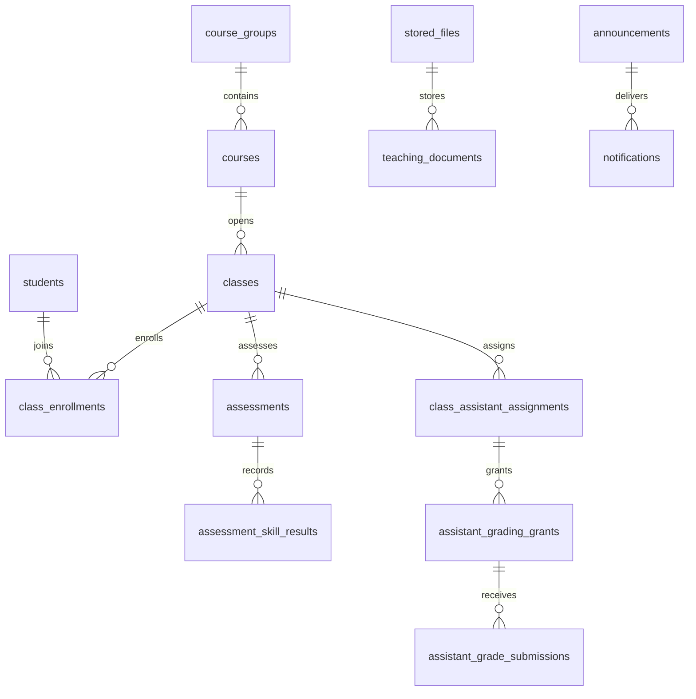

# Đối chiếu FE, BE và database NekoEDU

## Phạm vi

Đối chiếu source tại `D:\capstone1-NekoEDU\frontend` và Backend hiện tại. Schema đích là migration **0012**, gồm **69 bảng** (tính cả `alembic_version`) và 3 view tổng hợp mới. Migration 0010–0012 bổ sung 27 bảng vào schema 0009, giữ nguyên dữ liệu nghiệp vụ đã có.

FE ở checkout riêng `D:\capstone1-NekoEDU\frontend`, dựa trên nhánh `FE`, commit `2e05275`. Đợt tích hợp tiếp theo thay logic dữ liệu của các form Manager/Giảng viên bằng API SQL, giữ bố cục/CSS/menu. Xem `INTEGRATION_STATUS.md` để biết kết quả kiểm thử và giới hạn, `DEMO.md` để chạy. Không có migration mới trong đợt nối API này; sử dụng schema 0012 đã có.

Không sửa hay chạy lại SQL gốc `migrations/sql/0001_initial_schema.sql` trên database đang sử dụng. Không chạy seed trên database demo để nâng cấp.

## Đối chiếu Manager

| Màn FE | Bảng/cột lưu dữ liệu | Kết quả đối chiếu |
|---|---|---|
| Tổng quan | `students`, `classes`, `class_sessions`, `attendances`, `tuition_invoices`, `payments`, `finance_transactions`, `ai_alerts` | Số liệu tổng hợp lấy từ nghiệp vụ gốc, không tạo bảng KPI trùng dữ liệu. FE còn dùng số liệu mẫu |
| Học viên | `students`, `guardians`, `student_user_links`, `class_enrollments`, `student_level_transfers` | Đã có API chính; 0010 thêm `students.gender/address/contact_email` để đáp ứng form FE |
| Khóa học & Lớp học | `course_groups` → `courses` → `classes`; `rooms`, `class_enrollments` | 0010 thêm nhóm KINDY/KID/TEEN và `courses.group_id/curriculum_level`. Giữ `courses.level_id` làm cấp độ tuổi |
| Lịch | `class_schedules`, `class_sessions`, `attendances`, `attendance_histories` | Đã có cấu trúc và API lịch/buổi/điểm danh; FE còn dùng lịch mẫu |
| Giảng viên | `users` + `staff_profiles`; `classes.lecturer_id/assistant_id`, staff theo từng buổi | 0010 thêm ngày sinh, giới tính, địa chỉ, loại hợp đồng, chứng chỉ, `hourly_rate`. Giữ `rate_per_session` cũ |
| Điểm số | `assessments`, `assessment_results`, `assessment_result_histories`, `assessment_import_previews`; các bảng kỹ năng/quy trình bên dưới | Giữ API điểm đơn hiện có; 0011 thêm kỳ nhập điểm và 4 kỹ năng của FE |
| Học phí | `tuition_invoices`, `tuition_invoice_items`, `payments`, `receipts`, `discount_policies`, `student_discounts`, `tuition_cycles`, `tuition_adjustments` | 0012 thêm dòng chi tiết học phí/tài liệu/khác. Công nợ lấy từ header hóa đơn và thanh toán |
| Thu chi | `finance_categories`, `finance_transactions`, `finance_transaction_attachments`, `staff_payrolls` | 0012 thêm chứng từ và cách tính lương HOUR; giữ SESSION cho lịch sử cũ |
| Thông báo | `announcement_templates`, `announcements`, `announcement_classes/students/attachments/replies`, `notifications`, `notification_deliveries` | 0012 thêm soạn nháp/hẹn giờ/đối tượng/tệp/phản hồi và hàng đợi gửi; `notifications` giữ người nhận và trạng thái đã đọc |
| Tuyển sinh | `admission_leads`, `ai_forecast_runs`, `ai_forecast_points`, `ai_alerts` | Lead đã có API. 0012 thêm kết quả dự báo theo khóa/tháng/năm, xác suất tái đăng ký/nghỉ học, độ tin cậy và căn cứ; chưa có mô hình AI chạy thật |
| Phân quyền & Cài đặt | `roles`, `users`, `permission_resources`, `role_permissions`, `audit_logs` | 0010 thêm ma trận quyền và metadata khóa/xóa mềm tài khoản. Middleware hiện vẫn dùng chính sách quyền trong BE, chưa đọc ma trận mới |
| Thông tin cá nhân | `users`, `staff_profiles` | 0010 bổ sung trường của form. Đổi mật khẩu/xác thực đã có API; sửa hồ sơ FE còn minh họa |

Các nguồn FE chính: `src/components/Manager/components/`, `src/components/Manager/layout/menu.js`, `src/api/`.

## Đối chiếu Giảng viên

| Màn / dữ liệu FE | Bảng/cột SQL |
|---|---|
| Tổng quan, lịch dạy, lớp phụ trách | `classes`, `class_sessions`, `class_schedules`, `class_enrollments`, `staff_profiles` |
| Điểm danh, ghi chú, lịch sử sửa | `attendances`, `attendance_histories` |
| Kỳ nhập điểm: term/opensAt/closesAt/release/publishesAt/remind/autoLock | `assessment_grading_periods` |
| Bài kiểm tra: đầu vào/giữa kỳ/nhãn tùy chọn, nháp/chờ xác nhận | `assessment_workflows.test_code/display_label/review_state`; liên kết bài kiểm tra và lớp/khóa/kỳ |
| Nghe, Đọc, Nói, Viết và ghi chú | `assessment_skill_results.listening_score/reading_score/speaking_score/writing_score/note` |
| Phân công trợ giảng và quyền điểm danh/xem danh sách/tải tài liệu | `class_assistant_assignments` |
| Xin quyền nhập điểm | `assistant_grading_requests` |
| Mở/thu hồi quyền nhập trong một khoảng thời gian | `assistant_grading_grants` |
| Trợ giảng nộp điểm, giảng viên duyệt/trả lại | `assistant_grade_submissions`, `assistant_grade_submission_rows` |
| File gốc, tên, loại, kích thước, người tải | `stored_files` |
| Tài liệu, tên hiển thị, chia sẻ nhiều lớp, lịch sử thao tác | `teaching_documents`, `teaching_document_classes`, `teaching_document_events` |
| Nhận xét theo học viên/lớp/người viết | `student_comments` |

Nguồn đối chiếu: `src/api/giangvien.js` và `src/components/Lecturer/components/`. Nghiệp vụ Giảng viên hiện gọi `/api/v1/lecturer`, lưu ở các bảng dưới đây; không dùng localStorage/IndexedDB làm nguồn nghiệp vụ.



## Ràng buộc và cách giữ tương thích

- **Cấp độ:** giữ 8 mã BE hiện có (`KINDY`, `KID_1`…`KID_4`, `TEEN_1`…`TEEN_3`). FE chia nhóm/chương trình khác với cấp độ tuổi; không đổi mã hay xóa KID_4 để ép theo dữ liệu mẫu FE.
- **Điểm:** điểm kỹ năng từ 0–9, bước 0,5, có thể NULL khi nháp. Điểm đơn `assessment_results.score` và API cũ giữ nguyên miền giá trị. API workflow lưu điểm kỹ năng và điểm tổng hợp trong cùng giao dịch, chỉ công bố khi đủ điều kiện.
- **Phạm vi lớp:** khóa ngoại ghép kiểm tra bài kiểm tra/lớp/khóa/kỳ và học viên đã ghi danh đúng lớp. Không ghi điểm hay nhận xét cho học viên thuộc lớp khác.
- **Trợ giảng:** grant phải nằm trong kỳ nhập điểm; người nộp phải đúng trợ giảng được phân công và nộp trong thời gian có quyền. Trigger kiểm tra cả thay đổi kỳ/grant/phân công để không làm sai lịch sử đã nộp. Duyệt một bài nộp hợp lệ sau khi quyền đã hết hạn vẫn được phép.
- **File:** `stored_files.content` lưu nội dung nhị phân thật, từ 1 byte đến 20 MB; kích thước khai báo phải bằng `DATALENGTH(content)`. Tài liệu học tập giới hạn PDF/DOCX/PPTX/MP3. Thông báo và chứng từ dùng chung kho file, không chỉ lưu tên file giả.
- **Thông báo:** tối đa 5 vị trí tệp cho một thông báo; mỗi người nhận chỉ có một notification cho cùng thông báo. Trạng thái đã đọc dùng `notifications.is_read/read_at`. Bảng delivery lưu từng kênh để xử lý retry; cần worker/API gửi thật khi tích hợp.
- **Tài chính:** `tuition_invoices`/`tuition_cycles` là nguồn số tiền chính. `tuition_invoice_items` là các dòng tiền gốc trước giảm trừ; không cộng lại với header để tính công nợ. Nghiệp vụ phát hành chu kỳ đã tạo dòng TUITION cùng transaction; API chi tiết nhiều dòng sau này phải cập nhật header và các dòng nhất quán.
- **Lương:** dữ liệu cũ mặc định `calculation_basis='SESSION'`. Lương giờ dùng `'HOUR'`, bắt buộc `teaching_hours/hourly_rate` và tổng phải đúng công thức. Không tự suy đoán lương giờ từ lương buổi cũ.
- **Quyền và tài khoản:** API/middleware áp dụng DENY từ ma trận, khóa theo hạn và xóa mềm; không dùng ALLOW để vượt vai trò hoặc phạm vi lớp. Khóa hết hạn mở lại khi xác thực và vẫn vô hiệu hóa token cũ.
- **AI:** schema lưu kết quả, căn cứ và quyết định xử lý; không tạo ra kết quả dự báo thật khi chưa có dịch vụ AI. Xác suất/độ tin cậy giới hạn 0–100.

## Các view có thể dùng cho API

| View | Ý nghĩa |
|---|---|
| `v_staff_teaching_hours` | Tổng số buổi và giờ thực dạy theo nhân sự/tháng, chỉ tính buổi COMPLETED |
| `v_announcement_read_summary` | Số người nhận, số đã đọc, tỷ lệ đọc; không lưu số phần trăm mẫu |
| `v_student_tuition_balance` | Tổng phải thu/đã thu/còn nợ và hạn cũ nhất chưa thanh toán; bỏ hóa đơn CANCELLED |

## Nâng cấp và kiểm tra

Chạy từ thư mục Backend. `inspect` chỉ đọc trạng thái:

```powershell
.\.venv\Scripts\python.exe scripts\prepare_database.py inspect
```

Chạy kiểm thử trên database **mới, tên riêng kết thúc `_test`**. Script sao chép cấu hình kết nối nhưng thay đúng database, kiểm tra danh tính thực tế rồi mới chạy migration/pytest; không in chuỗi kết nối hoặc mật khẩu:

```powershell
.\.venv\Scripts\python.exe scripts\prepare_database.py test -- -q
```

Nâng cấp database `NEKO_EDU` từ 0009 sau khi kiểm thử đạt:

```powershell
.\.venv\Scripts\python.exe scripts\prepare_database.py upgrade --expected-revision 0009 --approved-revision 0010 --approved-revision 0011 --approved-revision 0012
```

Lệnh nâng cấp bắt buộc tạo backup **COPY_ONLY + CHECKSUM**, chạy **RESTORE VERIFYONLY**, rồi mới áp dụng migration. Sau đó kiểm tra revision, bảng, khóa ngoại/CHECK và số bản ghi của từng bảng cũ không giảm. Backup nằm trong thư mục backup mặc định của SQL Server; đường dẫn cụ thể được in ra khi chạy.

## Kết quả áp dụng ngày 08/11/2026

- `NEKO_EDU` trên `.\SQLEXPRESS` đã nâng từ 0009 lên **0012**: **69 bảng**, 3 view tổng hợp mới; không có khóa ngoại/CHECK bị tắt hoặc chưa được xác minh.
- Giữ nguyên số bản ghi của mọi bảng cũ, gồm **171 học viên, 15 lớp, 185 tài khoản, 488 hóa đơn, 427 thanh toán**. Tạo 488 dòng học phí tương ứng và ánh xạ 8 khóa học vào nhóm; không chạy seed trên database này.
- Sáu tổng tiền gốc được so sánh chính xác trước/sau và giữ nguyên: tiền gốc/phải thu/đã thu trên hóa đơn, tổng thanh toán, thu chi và lương. Tổng phải thu hóa đơn là 478.000.000đ; đã thu là 417.800.000đ.
- Đã kiểm tra 867 ca BE trên database riêng: 845 ca qua lượt toàn bộ, 22 ca hồ sơ/quyền/nhóm khóa qua lượt chạy lại sau khi sửa fixture catalog. Thêm 10 test offline cho chuỗi kết nối ODBC đều đạt; Python compile và kiểm tra định dạng diff đạt.
- Backup trước nâng cấp đã chạy `RESTORE VERIFYONLY WITH CHECKSUM` thành công:

```text
C:\Program Files\Microsoft SQL Server\MSSQL17.SQLEXPRESS\MSSQL\Backup\NEKO_EDU_BeforeUpgrade_20261108_062418_09b73f3dbf13.bak
```

`scripts/check_demo.py` kiểm tra kết nối, schema đích và dữ liệu mà không sửa DB. Không chạy `pytest` trực tiếp với cấu hình database demo; fixture test có thao tác downgrade/xóa dữ liệu. Các database test mới được giữ lại để kiểm tra, không thay thế database demo.

`seeds/03_seed.sql` đã tương thích schema mới, nhưng vẫn là lệnh **xóa và nạp lại dữ liệu**. Chỉ dùng khi chủ động tạo database mẫu riêng. Hai catalog `course_groups` và `permission_resources` được giữ qua reset; nhóm khóa và dòng hóa đơn mẫu được tạo lại nhất quán.

## Phần API/FE cần nối tiếp

Schema hoàn chỉnh không tự sửa endpoint. Trang Học viên đã nối API list/create/update cho tài khoản Backend; các trang Manager khác chủ yếu chưa nối hoặc còn dùng mock. BE chưa có API CRUD danh mục khóa/lớp/phòng, file/tài liệu, nhận xét, thông báo, ma trận quyền và một số quy trình điểm 4 kỹ năng/trợ giảng.

Thứ tự tích hợp có thể theo: danh mục khóa/lớp và ghi danh → lịch/điểm danh theo tài khoản thật → điểm 4 kỹ năng/quy trình trợ giảng → tài liệu/nhận xét → học phí/thu chi → thông báo/quyền → số liệu tổng quan/dự báo. Giữ giao diện FE gốc; phạm vi tích hợp được ghi trong tài liệu phát triển, không thêm banner kỹ thuật vào giao diện.
